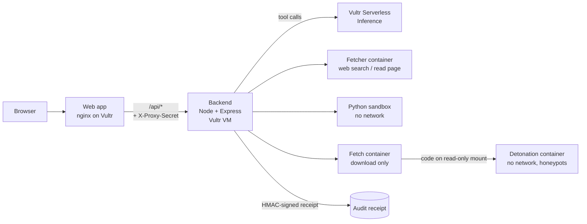

# Neora

**An AI agent that does real work and keeps its blast radius at zero.**

Neora is a web-based agent that researches, calculates and, above all, *inspects untrusted code and files* (npm / PyPI packages, GitHub repos, shell one-liners, uploaded files). Every risky action runs in a one-time, network-less Docker sandbox on Vultr that is destroyed afterwards, and every run leaves a signed audit receipt. Built for the **Vultr Agent Rush Hackathon**, Challenge 1: **Blast Radius Zero**.

**Live demo:** https://neora-ai-pearl.vercel.app

> Built on **Vultr Cloud Compute** (VM backend + web app) and **Vultr Serverless Inference** (all agent LLM calls).

---

## Why Neora

People paste `curl | sh` one-liners, install unknown packages and open unknown files every day. "Is this safe?" is a question an LLM cannot answer by reading alone, and running the thing on your own machine is exactly what you want to avoid.

Neora answers by **running it in a sandbox that cannot hurt anything** and reporting what it actually did. The verdict (`UNSAFE` / `SUSPICIOUS` / `LOOKS SAFE` / `INCOMPLETE`) is computed by code from observed behavior, never by the model.

## What the agent can do

| Tool | What it does | Where it runs |
|---|---|---|
| `web_search` | Searches the web | Fetcher container |
| `read_page` | Reads a public web page as plain text | Fetcher container, SSRF-guarded |
| `run_command` | Runs a restricted Python subset for calculations | Python sandbox, no network |
| `inspect_package` | Safety-tests an npm package, PyPI package, public GitHub repo or a pasted shell command | Two-stage fetch + detonation containers |
| `inspect_uploaded_file` | Static + dynamic analysis of an uploaded file | One-time detonation container |
| `write_report` | Produces a downloadable Markdown report | Data only, never executed |

Models are served by Vultr Serverless Inference (DeepSeek V4.1 Flash, GLM 5.3 Flash, GLM 5.3, GLM 5.2).

## Architecture



1. The browser talks only to the web app. The web app proxies `/api/*` to the backend and adds a shared secret; the backend rejects any request without it.
2. The backend runs the agent loop: it sends the conversation to Vultr Serverless Inference and executes the tool calls the model asks for, **each inside its own container**.
3. API keys live only on the host. They never enter any sandbox.
4. When a task ends, the container is removed, the removal is verified, and a signed receipt is attached to the answer.

### Inspecting a package (Blast Radius Zero in practice)

1. **Fetch stage:** a throwaway container downloads the package or repo with install scripts disabled.
2. **Detonation stage:** a second one-time container with **no network** runs install scripts, imports the package and executes entry points while a behavior hook records file, process, environment and network activity. Fake credentials (SSH, AWS, npm, git, kube, docker, wallet files and env vars) are planted as honeypots, so any attempt to steal them is visible.
3. Static rules also read strings inside binaries and archives.
4. Both containers and the temp files are destroyed; a containment receipt is added to the downloadable report.

Supported kinds: `npm`, `pip`, `github`, `command`. Dynamic runtimes for uploaded files: Node.js, Python 3, POSIX shell, Ruby, PHP CLI, Perl and Lua. Windows `.exe` files get static analysis plus a short offline run under Wine (always reported as **partial** coverage, never "clean").

## Containment guarantees

| Guarantee | How |
|---|---|
| **Process isolation** | One-time Docker container per run, non-root user (`65534`), all Linux capabilities dropped, `no-new-privileges` |
| **No network** | `--network none` for the Python sandbox and every detonation container |
| **Read-only filesystem** | `--read-only` root; only a small size-limited `tmpfs` is writable; samples are mounted read-only |
| **Resource limits** | CPU, memory (no swap) and process-count limits per container; file-size and open-file ulimits; Python sandbox has a 10 s timeout |
| **No secrets in the sandbox** | API keys stay on the host; secrets visible inside are fake honeypots |
| **Ephemeral lifecycle** | `--rm`, then the backend verifies the container is gone (`confirmed-absent`) and removes the temp directory |
| **Audit trail** | Every sandbox run emits a SHA-256 receipt (command hash, output hash, policy decision, timing, cleanup status), HMAC-signed when `AUDIT_HMAC_KEY` is set |
| **SSRF protection** | The web reader validates every DNS answer, pins the connection to the validated IP and re-validates every redirect; private, loopback, link-local and metadata ranges are blocked |

The Python sandbox additionally uses an AST allow-list: no imports, no attribute access, no private names, only a fixed set of built-in functions.

## Repository layout

```
backend/     Node.js (Express 5) agent backend, sandbox runners, tests
  server.mjs       API server
  chat.mjs         agent loop + tool definitions
  tools.mjs        Python sandbox runner (+ audit receipts)
  detonate.mjs     package / file inspection pipeline
  verdict.mjs      code-computed verdicts and reports
  security/        SSRF guard
  fetcher/         web search + page reader (runs in a container)
  probe/           detonation scripts, honeypots, behavior hooks
  sandbox/         Python AST runner
  wine/            Wine image for Windows samples
  deploy/          systemd unit, nginx config, Wine build scripts
frontend/    static web app (HTML / CSS / vanilla JS) + nginx config
```

## Quick start (Vultr VM)

**Requirements:** a Vultr Cloud Compute VM (Ubuntu 22.04+), Docker Engine, Node.js 22, and a Vultr Serverless Inference API key.

### 1. Backend

```bash
git clone https://github.com/ascentorvex/neora.git
cd neora/backend

npm ci
cp .env.example .env
# Fill in .env:
#   VULTR_KEY       your Vultr Serverless Inference key
#   PROXY_SECRET    openssl rand -hex 32   (same value as the web app proxy)
#   AUDIT_HMAC_KEY  openssl rand -hex 32   (signs audit receipts)
#   HOST=127.0.0.1  keep the backend private
```

Pull and build the sandbox images once:

```bash
docker pull python:3.12-alpine
docker pull node:22-alpine
docker build -t neora-det:1 probe/              # detonation image
bash deploy/build-wine.sh                       # optional: Wine image for .exe samples (~1.5 GB)
```

Optional hardening in `.env` (milliseconds; `0` or unset means no limit):

```bash
NEORA_FETCH_MS=60000        # download step
NEORA_DETONATE_MS=120000    # whole detonation container
NEORA_BUDGET_MS=60000       # total script run time inside the container
NEORA_RUN_MS=20000          # per-script limit
# SANDBOX_RUNTIME=runsc     # run detonation containers under gVisor if installed
```

Run it:

```bash
node --env-file=.env server.mjs
# or install deploy/neora-backend.service as a systemd unit
```

### 2. Web app

The web app is static files plus an nginx proxy that forwards `/api/*` to `127.0.0.1:3000` and injects the proxy secret.

```bash
cd ../frontend
echo 'proxy_set_header X-Proxy-Secret "<PROXY_SECRET>";' | sudo tee /etc/nginx/snippets/neora-proxy-secret.conf
docker build -t neora-web .
docker run -d --name neora-web --network host \
  -v /etc/nginx/ssl:/etc/nginx/ssl:ro \
  -v /etc/nginx/snippets:/etc/nginx/snippets:ro \
  neora-web
```

Put TLS certificates (`fullchain.pem`, `privkey.pem`) in `/etc/nginx/ssl`. Do not put the secret in any browser-delivered file.

For local development without nginx: `API_TARGET=http://127.0.0.1:3000 PROXY_SECRET=<secret> node serve.mjs`.

### 3. Verify

```bash
curl http://127.0.0.1:3000/health            # {"ok":true}
cd backend && npm test                       # unit tests for guard, sandbox policy, verdicts, uploads
```

Then open the web app and try: *"Is `npm install left-pad` safe?"* or upload a file and ask *"is this safe?"*. The answer includes a **Tools used** section with the sandbox receipt.

## API (all routes require `X-Proxy-Secret`)

| Route | Purpose |
|---|---|
| `POST /api/start` | Start an async job `{ url, goal, model, lang }` → `{ id }` |
| `GET /api/job/:id` | Poll live status and the final result |
| `POST /api/analyze` | Single-request mode |
| `POST /api/upload` | Raw file upload; returns a single-use 128-bit ID (expires after 30 min) |

## Known limits

- Wine is **not** a Windows VM. Windows executables are reported as partial coverage, and malware that sleeps longer than the observation window (default 30 s) or needs network access to activate will not be seen misbehaving.
- A "looks safe" verdict means *no malicious behavior was observed*, not a guarantee.
- The Python `run_command` tool is deliberately restricted to calculations.
- Inspection time limits are off by default; set the `NEORA_*_MS` variables for production use.
- Detonation containers share the host kernel unless `SANDBOX_RUNTIME=runsc` (gVisor) is configured.

## Tech

Vultr Cloud Compute · Vultr Serverless Inference · Docker · Node.js 22 / Express 5 · nginx · Wine · vanilla JS frontend

## License

MIT
